

 

**Бесплатное приложение для VPN. Вставьте свой ключ и нажмите одну кнопку.**

 

 

&nbsp;

🌐 Сайт: <a href="https://heavilyoffc.github.io/aurora-vpn/">heavilyoffc.github.io/aurora-vpn</a>
 
Windows без установки: <a href="https://github.com/heavilyoffc/aurora-vpn/releases/latest/download/Aurora-portable.exe">Aurora-portable.exe</a> · Все версии: <a href="https://github.com/heavilyoffc/aurora-vpn/releases">Releases</a>

 

## ✦ Скриншоты

### Windows

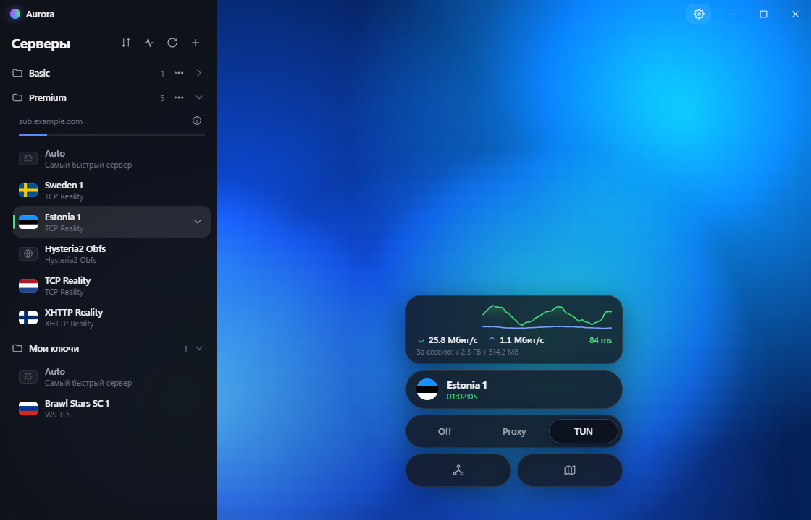

<table>
<tr>
<td width="50%">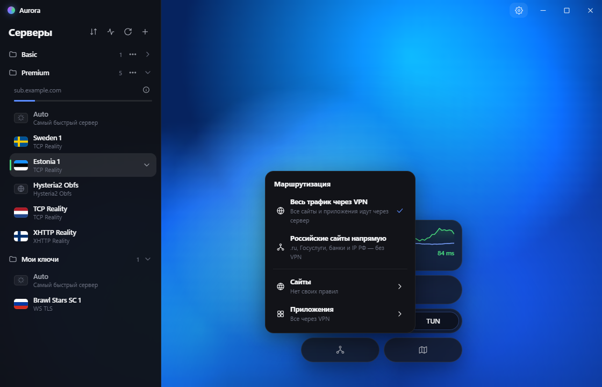
<b>Маршрутизация</b>
</td>
<td width="50%">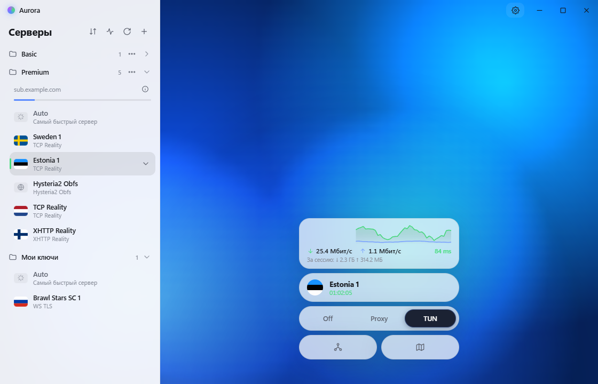
<b>Светлая тема</b>
</td>
</tr>
</table>

### Android

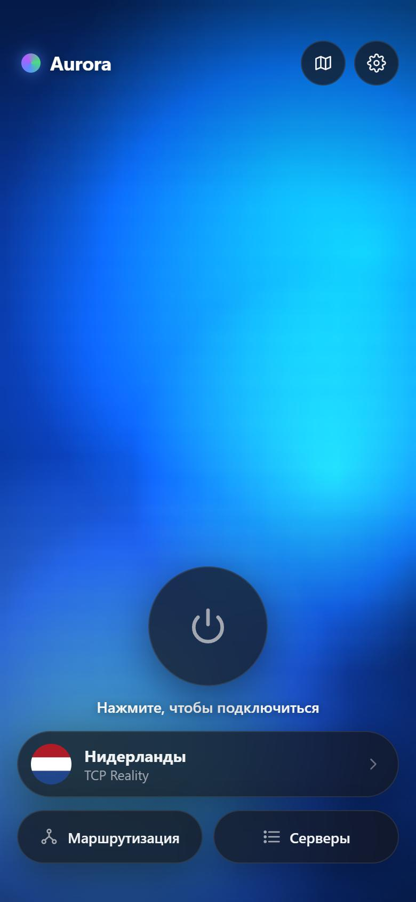
&nbsp;&nbsp;
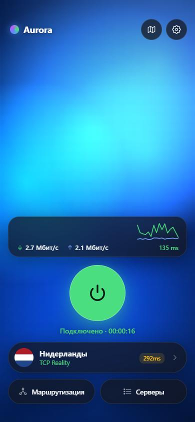
&nbsp;&nbsp;
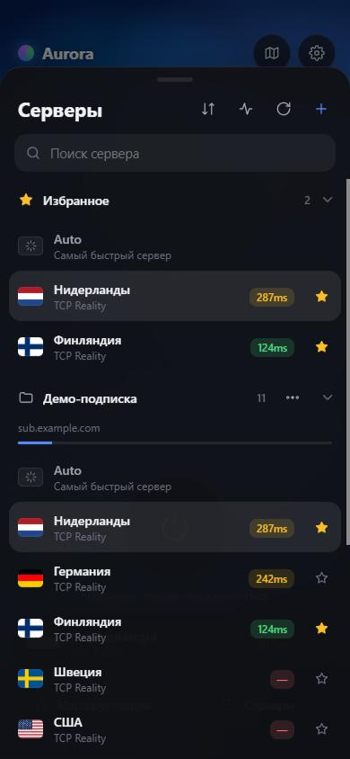
 
<b>Главный экран</b> · <b>Подключено</b> · <b>Серверы</b>

## ✦ Возможности

| | |
|---|---|
| 🔑 **Свой ключ** | Подходят ключи и подписки из Happ, v2rayN, Hiddify и других клиентов: VLESS, VMess, Trojan, Shadowsocks, Hysteria2, TUIC. |
| ⚡ **Одна кнопка** | Подключение и отключение одним касанием. |
| 🧭 **Маршрутизация** | Российские сайты напрямую или весь трафик через VPN. Свои правила для сайтов и приложений. |
| 🖥 **Proxy и TUN** | TUN пускает через VPN все программы на компьютере, Proxy включает системный прокси. |
| 📶 **Пинг и Auto** | Проверка пинга, избранное и автоматический выбор самого быстрого сервера. |
| 🎮 **Discord** | Статус в профиле Discord, пока VPN включён. Выключается в настройках. |
| 💸 **Бесплатно** | Без оплаты и подписок. |
| 🚫 **Без рекламы** | Ни баннеров, ни всплывающих окон. |

## ✦ Кастомизация

<table>
<tr>
<td width="33%">
<b>Аврора</b>
</td>
<td width="33%">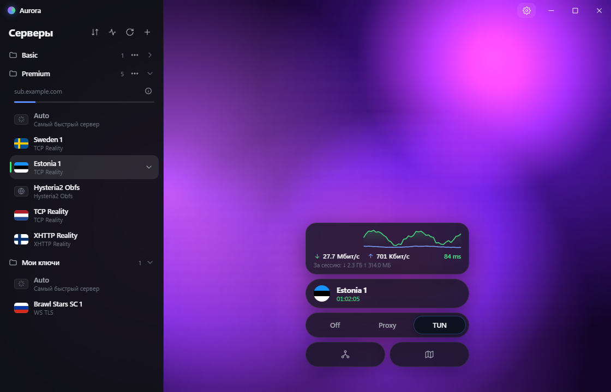
<b>Туманность</b>
</td>
<td width="33%">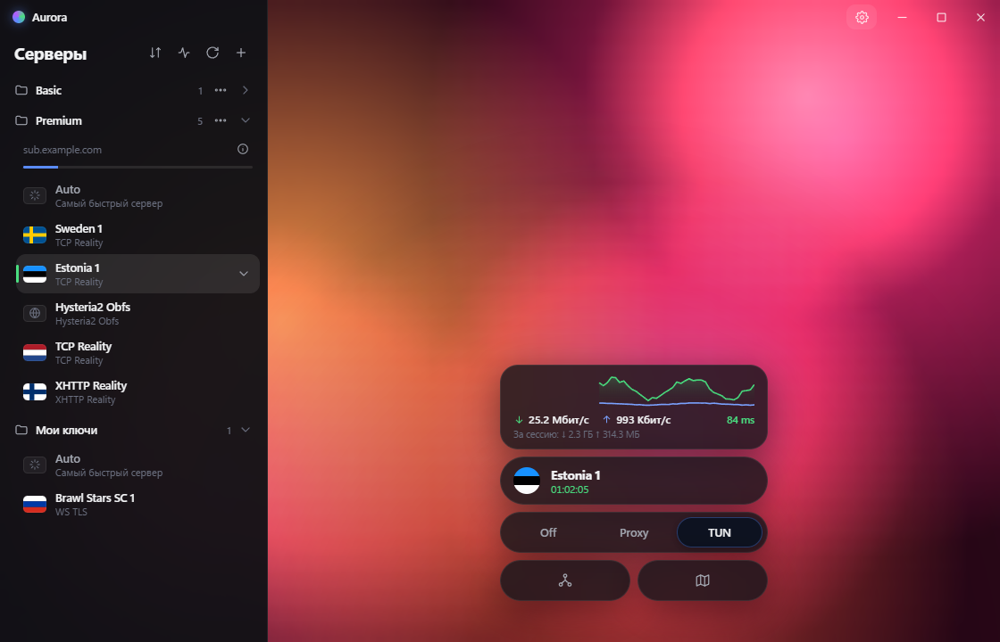
<b>Закат</b>
</td>
</tr>
<tr>
<td>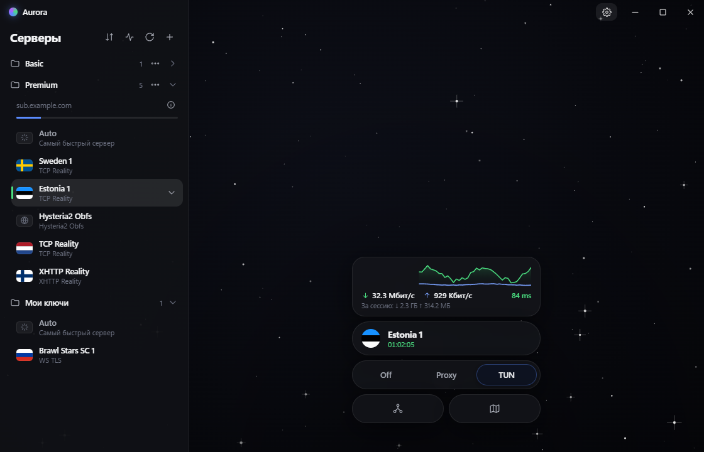
<b>Звёзды</b>
</td>
<td>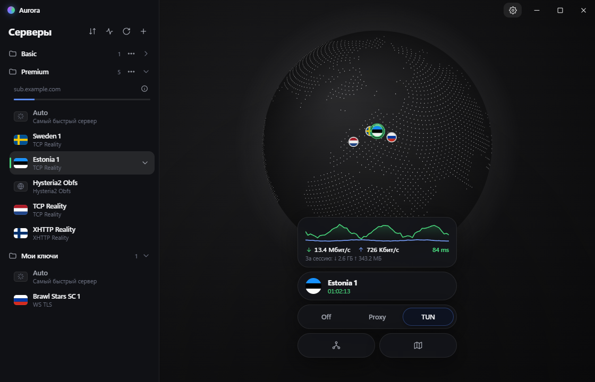
<b>Глобус</b>
</td>
<td>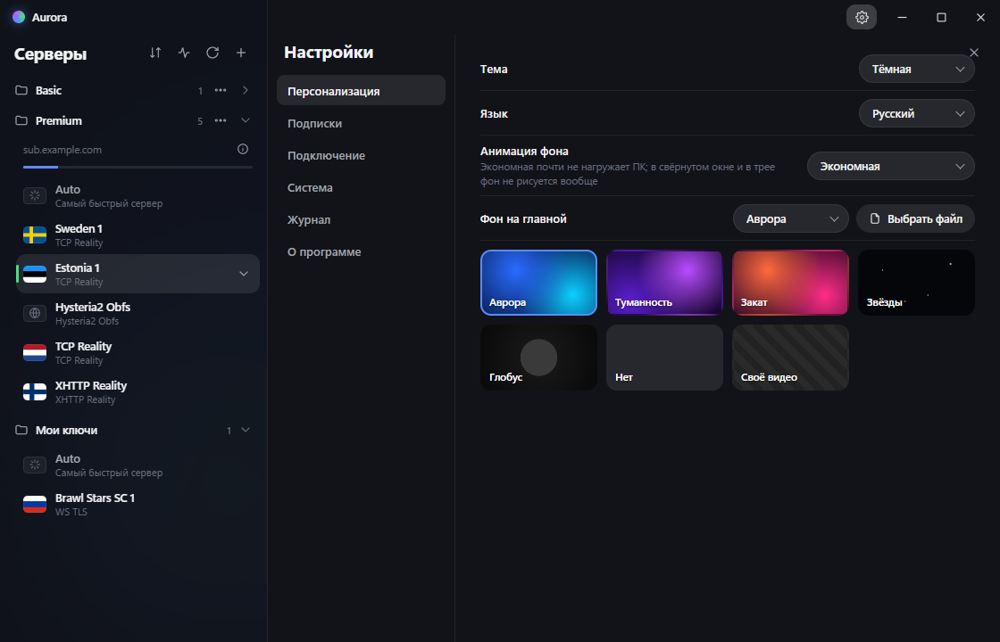
<b>Настройки</b>
</td>
</tr>
</table>

- 🌌 **5 живых фонов:** Аврора, Туманность, Закат, Звёзды и Глобус. На глобусе видно, где стоят ваши серверы.
- 🎬 **Своё видео:** выберите любой видеофайл, и он будет крутиться на главном экране.
- 🌗 **Тёмная и светлая тема.**
- 🔋 **Экономная анимация:** почти не нагружает компьютер, а в свёрнутом окне фон не рисуется вообще.
- 🌍 **Русский и English.**

## ✦ Как начать

1. **Скачайте** приложение по кнопке выше.
2. **Вставьте** свой ключ.
3. **Нажмите** большую кнопку. Готово!

## ✦ Установка

<b>Android</b>

 

1. Скачайте файл `Aurora.apk`.
2. Откройте его. Телефон может написать, что установка из неизвестных источников запрещена.
3. Нажмите **«Настройки»** и включите **«Разрешить установку из этого источника»**.
4. Вернитесь назад и нажмите **«Установить»**.

<b>Windows</b>

 

1. Скачайте файл `Aurora-Setup.exe` и запустите его.
2. Если появится синее окно **«Windows защитила ваш компьютер»**, нажмите **«Подробнее»**, затем **«Выполнить в любом случае»**.
3. Следуйте шагам установщика.
4. При запуске Aurora попросит права администратора. Они нужны, чтобы включать VPN.

Не хотите устанавливать? Скачайте `Aurora-portable.exe` и просто запустите его.

## ✦ Вопросы

<b>Что такое ключ и где его взять?</b>

 

Ключ — это строка с настройками подключения к VPN-серверу. Его выдаёт VPN-сервис или человек, который настроил сервер. Aurora — это приложение для подключения: серверы и ключи мы не продаём.

<b>Приложение правда бесплатное?</b>

 

Да. Скачать Aurora и пользоваться им можно без оплаты, подписок и рекламы.

<b>Есть ли Aurora для iPhone и Mac?</b>

 

Пока нет. Сейчас приложение работает на Android и Windows.

 

© 2026 Aurora VPN

